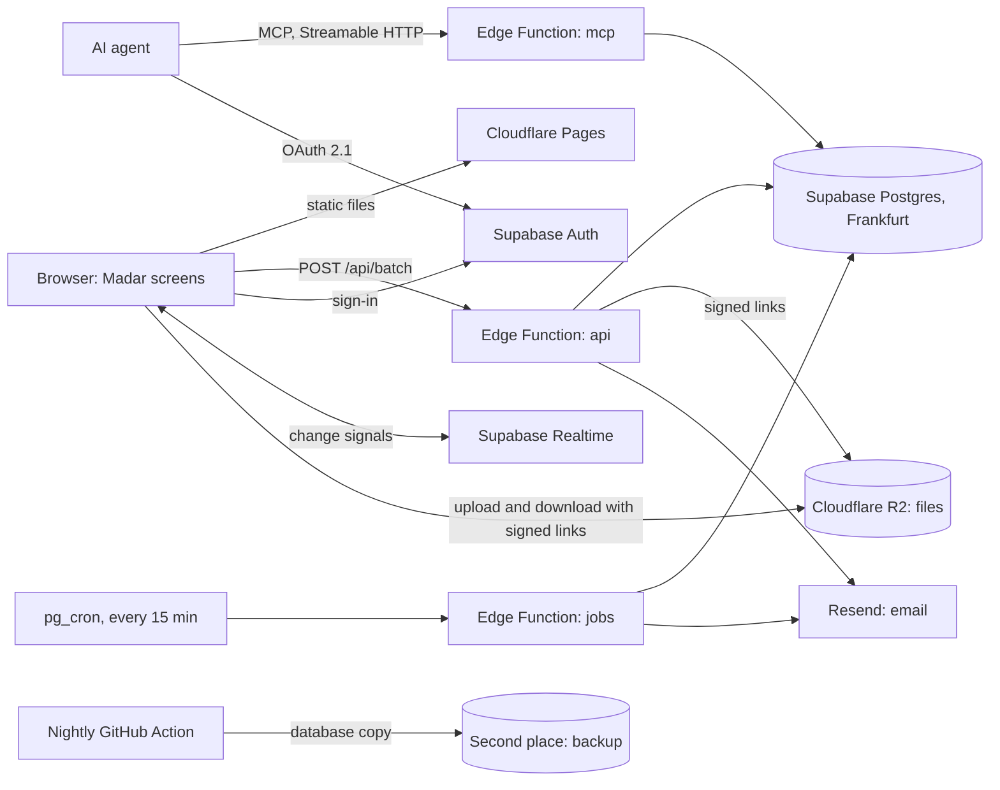

# Madar real build: design

**Date:** 2026-10-03
**Status:** Written. The build starts after the office team reviews and approves the prototype (first spec, section 1).
**First spec:** `docs/superpowers/specs/2026-09-30-madar-prototype-design.md`. This spec replaces its "real build (Python)" parts: section 11 (the FastAPI line) and section 17, rules 6 to 8.

## 1. Purpose

The prototype runs in one browser with sample data and a fake API. The real build gives the office one shared Madar: real accounts, one database, real files, email notices, and AI agents that work for a person. The screens of the prototype stay. The rules of the fake API (the 108 calls, the permission function, the event log, Undo) move to a real server with as little rewrite as possible.

## 2. Owner decisions (2026-10-03)

| Topic | Decision |
|---|---|
| Server language | TypeScript, the language of the prototype rules and their tests |
| Screens host | Cloudflare Pages, free plan |
| Server host | Supabase Edge Functions, free plan, Frankfurt. The code stays portable, so the server can move to Railway at any time |
| Database, sign-in, live updates | Supabase, free plan, Frankfurt. Upgrade when the office needs it |
| Files | Cloudflare R2, free plan (10 GB) |
| Email | Resend, free plan |
| Phone notices | None. A mobile app comes later and uses the same server |
| Sign-in | Email and password |
| First data | Empty. The team adds its own projects |
| AI agents (MCP) | In version 1, on the MCP version of 2026-07-28 |
| Data location | Frankfurt. The owner confirmed that client data may be stored there |
| Vendors | No money goes to Vercel (owner rule). Every part above is on a free plan |

Cost: $0 a month, plus the domain name (about $15 a year).

## 3. What changes from the prototype

- **Removed:** Preview as, Reset sample data, simulated errors (`session.previewAs`, `session.resetSampleData`, `session.setSimulateErrors`), and the sample office. Each person sees Madar as themselves.
- **Added:** sign-in, invitations, password reset, email notices, a storage meter for the Admin, the agent consent screen, and a settings page that lists the agents a person approved.
- **Same:** every screen, every rule, the two languages, Undo, the History, the meeting view.

## 4. Architecture

| Part | Job |
|---|---|
| `api` Edge Function | Runs the 108 calls for the screens. One request can carry several calls (section 5.4). |
| `mcp` Edge Function | Runs the same calls for AI agents, with written instructions (section 12). |
| `jobs` Edge Function | Runs the timed work: due reminders, stale checks, the email summary. |
| Postgres | Holds every record. Only the server reads and writes it. |
| Supabase Auth | Holds the passwords and the agent approvals. Madar keeps names, roles and settings in its own `users` table. |
| Realtime | Tells open screens that something changed, so they load again. |
| R2 | Holds file data. The database holds only the file records. |

All Edge Functions run in Frankfurt (`x-region: eu-central-1`), next to the database.

## 5. Server

### 5.1 One code base, two homes

The server is one standard web handler (a `fetch(request)` function, with Hono for routes). It runs on Deno (Supabase Edge Functions) and on Node (Railway) with no change. The code uses no feature that only one host has. The project keeps a setup file for each host, and step 1 of the build deploys a test copy to both.

### 5.2 The calls

The 108 calls keep their names, inputs and outputs (the zod contract in `src/api/contract`). The screens call `POST /api/batch` with a list of `{ name, input }`. `session.get` returns the signed-in person.

### 5.3 How the rules run on real data

The prototype rules change a `State` object in memory. The real build keeps those rules and wraps them in three steps:

1. **Load.** The server reads the records that the call needs into a `State` object of the same shape. A call that works on one project loads that project and the office lists (people, teams, settings). A call for the whole office (Dashboard, Search, Inbox) loads the office without old events.
2. **Run.** The same `run(input, ctx)` code runs as in the prototype.
3. **Save.** The server compares the `State` before and after, and writes only the changed records in one database transaction. A failure writes nothing, the same rollback as `Store.run` today.

Writes for the office run one at a time, under one database lock (`pg_advisory_xact_lock`). For 15 people this costs nothing, and it removes every "two people changed the same task at once" case. Reads run in parallel.

### 5.4 Fewer requests

The free plan allows 500,000 server calls a month. The prototype loads every list again after each change, which would use about 1,000,000 a month for 15 people. Three rules keep the real build well under the limit:

- **Batch.** The screens group the calls of one moment into one request.
- **Load only what changed.** A change signal names the project, so a screen loads again only the lists of that project.
- **No timer polling.** Screens load on a change signal or on a visit, never on a timer.

The Admin page shows the calls used this month. At 80% of the limit, Madar tells the Admin by email.

### 5.5 Story IDs come from the server

MCP 2026-07-28 says that the server makes any ID that links several calls. A call that comes with no story ID gets a new one from the server, and the result returns it, so the Undo toast can use it. A screen or an agent that wants several calls in one story first asks for an ID with `story.start`, then passes it with each call. The server accepts only story IDs it made, for the same person, in the last 24 hours. This closes the "forged story" class of bugs (audit V-2) at the root.

### 5.6 Undo and a change log that only grows

The first spec (17.8) says the change log has no update and no delete path. The prototype marks an undone event with `undoneBy`, which is an update. In the real build, an Undo writes a new `undo` event that names the undone event, and `undoneBy` becomes a value that the server reads from those `undo` events. The database refuses `UPDATE` and `DELETE` on the `events` table for every role.

## 6. Database

- **Tables:** one table for each entity in the zod contract (users, teams, clients, projects, members, stages, deadlines, tasks, updates, comments, reactions, files, file versions, events, notifications, chats, messages, chat reads, tracker entries, payments, stage templates, task templates, feedback, settings). Columns follow the zod fields. Lists that never leave their parent (checklist, date notes, task versions) stay as JSON columns.
- **Access:** Row Level Security is on for every table, with no policy for the browser roles. So the browser cannot read or write a table directly, and every rule stays in the one permission function `can()`. The server uses the service key.
- **Changes to the tables** go through numbered migration files in the repository. The prototype's `STATE_VERSION` steps are not needed: the office starts empty.

## 7. Sign-in and people

- Email and password, with Supabase Auth.
- No open sign-up. The Admin adds a person, and Madar emails an invitation link. The person sets a password and signs in.
- "Forgot password" sends a reset link by email.
- The first Admin account is made once by a setup script.
- Roles (Admin, Management, Accounting, Member), gender for Arabic grammar, language and notice settings stay in Madar's `users` table.
- Turning a person off (Admin, People) also stops their sign-in and their agents.

## 8. Files

- The server gives the browser a signed upload link to R2, valid for 10 minutes. The browser sends the file straight to R2, so a big file never passes through the server.
- Downloads and previews use signed links that last 10 minutes.
- One file can be up to 250 MB. The free plan holds 10 GB in total.
- The Admin page shows the storage used. At 80%, Madar tells the Admin by email. The office then pays R2 for more space or removes old versions.
- Deleting a project removes its file data after the delete is saved (the review fix of 2026-10-03).

## 9. Live updates

After each saved change, the server sends one Realtime message on the office channel: the project and the kinds of records that changed. Each open screen loads again only the lists it shows for that project. The channel is private: only signed-in people of the office can listen. The free plan allows 200 open screens at once.

## 10. Email (Resend)

- **Sender:** `notices@<madar domain>`, set up with the domain's DNS records, so the mail does not go to spam.
- **Supabase sign-in mail** (invitations, password reset) also goes through Resend. Supabase's own mail sends only 2 emails an hour.
- **What goes by email:** each notice type has an "Email" switch in Settings, Notifications, next to the in-app switch. Defaults, so nobody gets noise: email is on when a task is assigned to me, when a review waits for me, and when someone mentions me. It is off for the rest.
- **Morning summary:** one email at 07:30 Riyadh time on working days, with the tasks due today and the reviews that wait. It is on by default and has its own switch.
- Each email is in the person's language and direction (Arabic right-to-left).
- **Limit:** the free plan sends 100 emails a day. Madar keeps a count and sends no more than 90 notice emails a day. After that, notices stay in the app and the Admin gets one warning.

## 11. Timed work

- `pg_cron` calls the `jobs` function every 15 minutes: due reminders, stale paused projects, and the morning summary.
- The prototype's `runScheduledTriggers` rules move there unchanged.
- The same timer keeps the free Supabase project awake (Supabase pauses a free project after a week with no use).

## 12. AI agents (MCP, version 2026-07-28)

- **Address:** one MCP address over Streamable HTTP. No sessions: each request stands alone, as the new version requires.
- **Discovery:** the server answers `server/discover` with its versions, abilities and name.
- **Tools:** one tool for each of the 108 calls, plus `story.start` and `madar.readFirst`. Each tool has a written instruction for agents. The input rules come from the zod schemas as JSON Schema 2020-12. `tools/list` returns the tools in a fixed order, with a cache time (`ttlMs`) and `cacheScope: "private"`.
- **Questions to the agent:** when a change needs a reason (a stage moves back, a date changes), the server returns `input_required` with the question. The agent asks its person, then sends the request again with the answer. This is the same flow as the reason sheets on the screens.
- **Sign-in:** OAuth 2.1 with PKCE through Supabase Auth's OAuth server. A person approves each agent on Madar's consent screen. The identity comes only from that approval. The MCP function publishes its Protected Resource Metadata (RFC 9728) and checks that each token was issued for Madar.
- **Agent rules:** the first spec, section 17, rules 1 to 5, stay as written. An agent acts for one person with that person's rights, its changes show its name and the person's name in the History, and the person can undo them.
- **Settings, Agents:** each person sees the agents they approved and can remove one at once.

## 13. Backups and recovery

- **Nightly:** a GitHub Action makes a full copy of the database at 02:00 Riyadh time. It encrypts the copy and stores it in a second place outside Frankfurt and outside Supabase. The copies are kept for 30 days.
- **Files:** R2 keeps the file data. A weekly copy of the R2 bucket goes to the same second place.
- **Restore test:** step 7 of the build restores a copy into the second Supabase project and checks it. After go-live, the restore test runs once a month.
- **Why:** the free Supabase plan has no backups. Also, in March 2026 strikes damaged Amazon's data centres in the UAE and Bahrain, and Amazon could not restore data held only there. One copy is never enough.

## 14. Security

- Every rule stays in the server, in `can()`. The browser has no direct database access (section 6).
- Each request carries the person's sign-in token. The server checks it on every call.
- Secrets (service key, R2 keys, Resend key) live only in the hosts' secret stores, never in the repository.
- Sign-in and invitations are rate-limited.
- The security fixes of the audits stay: link safety, agent ownership, helper Undo, the story checks.
- Before go-live, an independent security review of the server and the MCP sign-in.

## 15. Free-plan limits to watch

| Limit | Free amount | Expected for 15 people | Action at 80% |
|---|---|---|---|
| Server calls | 500,000 a month | about 150,000 with batching | Email to the Admin; upgrade Supabase |
| Database | 500 MB | under 100 MB in the first year | Email to the Admin |
| Files | 10 GB (R2) | depends on uploads | Email to the Admin |
| Emails | 100 a day | 20 to 60 | Notices stay in the app |
| Open screens at once | 200 | under 30 | None needed |
| Screen builds | 500 a month | under 100 | None needed |

## 16. Tests

- The 1,640 prototype tests stay.
- The API tests also run against a local Supabase (Docker) with the real load, run and save steps (section 5.3). The same test must pass on both.
- New tests: sign-in, invitations, the advisory lock under parallel writes, signed file links, email limits, the MCP flow (discover, OAuth, tools, `input_required`), and a backup restore.
- The browser checks (English and Arabic, light and dark, phone and computer) run against the test copy.

## 17. Build order

1. **Proof.** A minimal Madar on all the parts together: one screen, one call, sign-in, one file, one email, and a test deploy on Railway. If a part fails here, we change it before more work.
2. **Data.** The tables, the load, run and save steps, the batch request, and the 108 calls on real data.
3. **People.** Sign-in, invitations, password reset, the first Admin, and the removal of the prototype-only controls.
4. **Files.** R2 with signed links, the storage meter.
5. **Live and email.** Realtime signals, timed work, Resend, the email switches and the morning summary.
6. **Agents.** The MCP function, the consent screen, Settings, Agents.
7. **Go-live.** Backups and the restore test, the security review, the limit warnings, and a pilot: 2 or 3 people use it on real projects for 2 weeks. Then the whole office.

## 18. Risks

| Risk | What we do |
|---|---|
| Supabase's OAuth server documents only the older agent registration (Dynamic Client Registration), which MCP now marks as deprecated | Check at step 1. Older registration still works today; if a main AI app drops it, we add Client ID Metadata Documents in the MCP function |
| A heavy call (Dashboard) uses more than 2 seconds of server CPU | Measure at step 2. If needed, the Dashboard reads a summary table that the server keeps up to date |
| Frankfurt is far from Khobar | About 0.1 seconds per request. Batching keeps the number of requests low |
| A free plan changes its terms or limits | The code stays portable (section 5.1). Railway is the fallback for the server |
| The team review changes screens | The server work does not depend on the screens, so steps 1 and 2 can start before the review ends |

## 19. Open items

- The office team reviews the prototype.
- A native speaker reads the new Arabic sentences.
- The trademark and domain check for the name "Madar", then the domain purchase.
- At build time, the owner creates free accounts at Cloudflare, Supabase, Resend and GitHub (for the backups).
